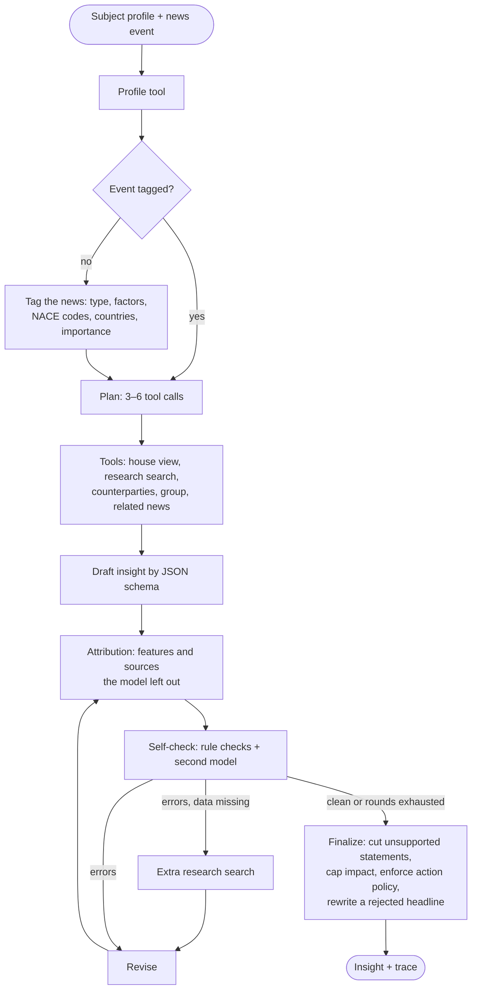

# Refract

**A traceable LLM agent that turns a news event into a grounded, personalised insight — for a company, a sole proprietor, a self-employed person or a private individual.**

[](https://github.com/Rinneway/refract/actions/workflows/ci.yml)


[Русская версия](README.ru.md)

One piece of news means different things to different readers. Refract *refracts* it through the profile of each reader: what happened, why it matters **to them**, which risks and opportunities follow, what the institution's analysts think, and what can be done next. Every statement carries its **origin** — fact, house view, AI inference or hypothesis — and the **sources** it rests on. Code, not the model, enforces grounding, caps the impact level and decides which products may be offered. Every step is recorded in a trace.

```text
ev_rate_hold_ru  ×  demo_building_materials (wholesaler with loans, a developer as its largest customer)
→ headline   The 14% rate stays: cheaper loans and leasing are postponed
→ why        [AI inference] loans and leasing — debt service will not get cheaper   (features: products.loans …)
             [Hypothesis]   the largest customer is a developer (31% of incoming payments) …
→ house view [Demo Bank view] rate to stay at 14% until end-2026        (p. 2 of the macro outlook)
→ action     discuss fixing the rate — product: fixed-rate loan        (rule fix_rate fired)
→ trace      rule check caught an invented “1.2 bn” → revision → policy removed a product no rule allows
```

## Contents

- [Why Refract](#why-refract)
- [How it works](#how-it-works)
- [Quick start](#quick-start)
- [Interfaces](#interfaces)
- [Configuration](#configuration)
- [Evaluation and research use](#evaluation-and-research-use)
- [Project layout](#project-layout)
- [Data and confidentiality](#data-and-confidentiality)
- [Limitations](#limitations)
- [Citing](#citing) · [License](#license)

## Why Refract

- **Personalised, not summarised.** Every “why it matters” statement must cite features of the subject (`products.loans`, `counterparties.customer.cp_dev_101`, `tax_regime`…). Unknown feature keys are rejected by code.
- **Provenance on every statement.** `fact` · `house_view` · `ai` · `hypothesis`. A statement attributed to the institution must cite its research; a fact must cite a source; a hypothesis carries a caveat.
- **Deterministic guard rails.** Numbers absent from the context are caught; the impact level is capped by a ceiling computed from subject–event links; products appear only when a policy rule fired on the subject's features. A prompt injection in the news cannot raise the impact or add a product.
- **Self-verification.** Rule checks plus a review by a second model; the agent searches for more data, revises, and cuts what still fails.
- **Any subject.** Companies, sole proprietors, self-employed people and private individuals, with reader roles from CFO and treasurer to “entrepreneur” and “individual”.
- **Bilingual.** Insights in Russian or English, whatever the language of the news.
- **Provider-agnostic.** Any OpenAI-compatible endpoint: OpenAI, OpenRouter, LiteLLM, vLLM, Ollama, LM Studio — with per-step model routing, failover, cost accounting and a disk cache.
- **A personal feed.** Of a hundred news items, code picks the few that concern this subject and says why, before any model is asked.
- **Ready to integrate.** Python API, CLI, REST API with live progress (SSE), MCP server, RSS collector.
- **Ready to study.** Built-in ablations, baselines, multiple LLM judges, inter-judge agreement and bootstrap confidence intervals.

## How it works



| Component | Where | What it does |
| --- | --- | --- |
| Orchestrator | `agent/orchestrator.py` | the loop above; `AgentConfig` switches components off for ablations |
| Context | `agent/context.py` | subject features with keys, the event, links, the house view, the source registry |
| Impact ceiling | `agent/impact.py` | strength of each subject–event link → the highest impact level allowed |
| Rule checks | `agent/checks/`, `schemas/insight.py` | sources, origins, feature keys, numbers, the ceiling; attribution repair, pruning and restoring |
| Action policy | `agent/actions.py`, `policies/actions.json` | which rules fire; product names, one product per insight, manager first on high negative impact |
| Chat | `agent/chat.py` | follow-up questions on the same context, with the same checks |
| Prompts | `prompts/` | every step in Russian and English, versioned |

Details: [docs/agent.md](docs/agent.md) · [docs/architecture.md](docs/architecture.md) · [docs/data-model.md](docs/data-model.md).

## Quick start

Requires Python 3.10+. With [uv](https://docs.astral.sh/uv/):

```bash
git clone https://github.com/Rinneway/refract.git
cd refract
uv sync --all-extras
uv run refract demo            # scripted run — no API key needed
uv run refract demo injection  # a news item with a prompt injection
uv run refract demo dollar     # an English run: a misattributed house view and a rejected headline
```

The demo scripts the model's answers; tools, retrieval, rule checks, the impact ceiling, the action policy and the trace are real.

With a model:

```bash
cp .env.example .env            # set LLM_BASE_URL, LLM_API_KEY, REFRACT_MODEL
uv run refract profiles         # synthetic subjects in examples/demo
uv run refract events
uv run refract analyze --profile demo_coffee_ip --event ev_usn_vat_ru --role entrepreneur --lang en --out runs/
uv run refract analyze --profile demo_family_saver --role individual \
    --title "Mortgage rates fall below 18%" --text-file news.txt
uv run refract chat --run runs/<insight_id>.json --q "What does it mean for my plans to open a bakery?"
```

Free: [Ollama](https://ollama.com) locally (Ollama Cloud now bills in credits beyond a few starter models) — copy [`examples/config/ollama-local.toml`](examples/config/ollama-local.toml) or [`ollama-cloud.toml`](examples/config/ollama-cloud.toml) to `refract.toml` and run `uv run refract check`: it verifies structured output, the context window and hidden reasoning before you spend time on runs. Providers without native structured output fall back to JSON mode and then to the schema in the prompt.

With pip: `pip install "refract-agent[api,mcp,pdf] @ git+https://github.com/Rinneway/refract"`.

## Interfaces

**Python**

```python
from refract import Refract

rf = Refract.from_dir("examples/demo")
run = rf.analyze("demo_london_studio", "ev_dollar_en", role="cfo", language="en")
print(run.insight.headline, run.insight.overall_impact)
for claim in run.insight.why_it_matters:
    print(claim.origin.value, claim.text, claim.source_ids, claim.features)
answer = rf.chat(run.insight.insight_id, "Should we hedge?").response
```

**REST API** — `uv run refract serve`, OpenAPI docs at `/docs`:

```bash
curl -s localhost:8000/insights -H 'content-type: application/json' \
  -d '{"profile_id": "demo_grain_farm", "event_id": "ev_wheat_en", "language": "en"}'
# → {"job_id": "…"}; live steps: curl -N localhost:8000/jobs/<job_id>/stream
```

**MCP** — `uv run refract mcp` exposes `list_profiles`, `news_feed`, `analyze_news`, `ask_followup`, `get_trace`, `search_research` to Claude Desktop, Cursor and other MCP clients.

**News** — `refract news fetch --feeds examples/feeds.example.json --data my_data` collects RSS/Atom feeds into deduplicated events (titles, links, feed summaries; no full texts). `refract feed --profile demo_coffee_ip` ranks the stored news for one subject by code — which concern it directly, which are background, and why; `--analyze 3` explains the top three.

**Your own research** — put Markdown, text or PDF files into `knowledge/docs/`; `refract theses --docs … --out knowledge/theses.json` extracts the institution's theses and keeps only those whose quote is found verbatim on the page.

All interfaces: [docs/integrations.md](docs/integrations.md).

## Configuration

Environment variables (or `.env`) override `refract.toml` (see [`refract.example.toml`](refract.example.toml)).

| Variable | Default | Purpose |
| --- | --- | --- |
| `LLM_BASE_URL` | `https://api.openai.com/v1` | endpoint; several, comma-separated, are tried in order |
| `LLM_API_KEY` | — | key for the endpoint |
| `REFRACT_MODEL` | `gpt-4o-mini` | model for tagging, planning, drafting, revising and chat |
| `REFRACT_VERIFIER_MODEL` | = `REFRACT_MODEL` | model for the review step and default judge; another family is better |
| `REFRACT_LANGUAGE` | `ru` | language of insights: `ru` or `en` |
| `REFRACT_EMBEDDING_MODEL` | — | enables hybrid BM25 + dense retrieval |
| `REFRACT_DATA_DIR` | `examples/demo` | folder with `profiles/`, `events/`, `knowledge/` |
| `REFRACT_API_TOKEN` | — | require `Authorization: Bearer …` on the REST API |

In `refract.toml` you can also route each step to its own model, set prices for cost accounting, name the institution whose research forms the house view, switch product offers off, and point to your own roles and action rules. See [docs/configuration.md](docs/configuration.md).

## Evaluation and research use

```bash
refract eval pairs  --data examples/demo --out runs/exp1/pairs.jsonl --languages ru,en
refract eval run    --out runs/exp1 --systems full,no_plan,no_verifier,no_rules,no_cap,no_policy,single_call,retelling
refract eval judge  --out runs/exp1 --judges verifier,judge2
refract eval label export --out runs/exp1 --sample 40   # optional: a blinded sheet for human labels
refract eval label import --out runs/exp1
refract eval report --out runs/exp1 --reference full
```

- **Systems:** the full agent, nine ablations (`no_plan`, `no_verifier`, `no_rules`, `no_revise`, `no_self_check`, `no_cap`, `no_policy`, `no_attribution`, `no_reconcile`) and two baselines (`single_call` — the same prompt and house view in one call; `retelling` — one call with a plain prompt).
- **Judge metrics:** six questions scored 0–2 (what happened, why it matters, consequences, actions, house view, grounding), overall 1–5, unsupported statements, retelling and impact calibration.
- **Code metrics** that need no judge: rule errors reaching the reader, invented numbers, impact above the computed ceiling, answers not in the requested language, cost, latency; results are also split by output language.
- **Human labels:** a blinded, shuffled sheet with the judge's rubric; imported as one more judge, so the report shows how far each LLM judge agrees with people.
- **Statistics:** 95% bootstrap CIs, paired differences, sign tests, quadratic-weighted κ and Spearman for every pair of judges, accuracy and κ against human labels.
- **Reproducibility:** prompt versions and the agent configuration are written into every trace; model answers are cached by request hash.

Method, metrics and threats to validity: [docs/evaluation.md](docs/evaluation.md). A plan for a paper: [docs/paper/outline.md](docs/paper/outline.md).

## Project layout

```text
src/refract/
  agent/        orchestrator, context, tools, checks, impact ceiling, action policy, chat, progress
  prompts/      prompts of every step, ru + en
  schemas/      Pydantic contracts and the shared vocabulary (factors, NACE, ISO countries)
  knowledge/    data store, BM25 / hybrid retrieval, document ingestion, thesis extraction
  llm/          OpenAI-compatible client, scripted model for tests and demos
  eval/         experiments, judges, statistics, report
  news/         RSS / Atom collector
  policies/     reader roles and action rules (JSON)
  api.py  mcp_server.py  cli.py  facade.py  render.py  demo.py
examples/demo/  synthetic profiles, news, research and evaluation pairs (ru + en)
docs/           architecture, agent, data model, configuration, integrations, evaluation, paper outline, JSON Schemas
tests/          159 tests on a scripted model and a fake OpenAI-compatible server — no network needed
```

## Data and confidentiality

Refract grew out of the author's agent component in an earlier team project on news analytics. That project worked with data and documents that cannot be published, so this repository is a standalone re-implementation and **contains none of them**: no client data (even anonymised), no internal research or theses, no infrastructure addresses, no keys. Everything in `examples/` — subjects, news, research notes and the “Demo Bank” itself — is invented; numbers in it do not describe real events. A test fails if strings shaped like client ids of the original data or like API keys appear anywhere in the repository. Details: [docs/provenance.md](docs/provenance.md).

## Limitations

- Insights are only as good as the profile: the agent sees what the profile says and nothing else; it does not know about products at other institutions.
- Number checks match numbers against the whole context, not the cited source; a number that appears elsewhere in the context passes.
- The impact ceiling and the action policy are hand-written rules; thresholds are configurable but not learned.
- English prompts are translations of prompts tuned on Russian news; check them with the parity run in [docs/evaluation.md](docs/evaluation.md#checking-the-english-prompts) before relying on them.
- An LLM judge is not a human expert; report agreement between judges and validate on human labels.

Refract produces information, not individual investment, tax or legal advice.

## Citing

If you use Refract in research, please cite it via [`CITATION.cff`](CITATION.cff) (GitHub shows a “Cite this repository” button).

## License

[MIT](LICENSE). Contributions are welcome — see [CONTRIBUTING.md](CONTRIBUTING.md).
