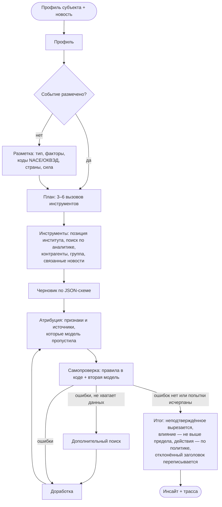

# Refract

**Агент на LLM с трассой рассуждений: превращает новость в обоснованный персональный инсайт для компании, ИП, самозанятого или частного лица.**

[](https://github.com/Rinneway/refract/actions/workflows/ci.yml)


[English version](README.md)

Одна и та же новость значит разное для разных читателей. Refract «преломляет» её через профиль читателя. Он объясняет, что произошло и почему это важно **именно ему**, какие риски и возможности появляются, что думают аналитики института и что можно сделать. У каждого утверждения есть **происхождение** — факт, позиция института, вывод AI или гипотеза — и **источники**, на которые оно опирается. Обоснованность проверяет код, а не модель. Он же ограничивает уровень влияния и решает, какой продукт можно предложить. Каждый шаг записывается в трассу.

```text
ev_rate_hold_ru  ×  demo_building_materials (оптовик с кредитами, крупнейший покупатель — застройщик)
→ заголовок  Ставка 14% сохраняется: удешевления кредитов и лизинга в ближайшие месяцы не будет
→ почему     [Вывод AI] есть кредиты и лизинг — обслуживание долга не подешевеет  (признаки: products.loans …)
             [Гипотеза] крупнейший покупатель — застройщик (31% входящих платежей) …
→ позиция    [Позиция Демо-банка] ставка 14% до конца 2026 года          (макрообзор, стр. 2)
→ действие   обсудить фиксацию ставки — продукт: кредит с фиксированной ставкой  (сработало правило fix_rate)
→ трасса     проверка нашла выдуманные «1,2 млрд» → доработка → политика убрала продукт, которого нет в правилах
```

## Содержание

- [Чем Refract отличается](#чем-refract-отличается)
- [Как это работает](#как-это-работает)
- [Быстрый старт](#быстрый-старт)
- [Интерфейсы](#интерфейсы)
- [Настройка](#настройка)
- [Оценка качества и исследования](#оценка-качества-и-исследования)
- [Структура репозитория](#структура-репозитория)
- [Данные и конфиденциальность](#данные-и-конфиденциальность)
- [Ограничения](#ограничения)
- [Цитирование](#цитирование) · [Лицензия](#лицензия)

## Чем Refract отличается

- **Персонализация, а не пересказ.** Каждое утверждение «почему это важно» должно ссылаться на признаки субъекта: `products.loans`, `counterparties.customer.cp_dev_101`, `tax_regime`… Неизвестный ключ признака код отклоняет.
- **Происхождение у каждого утверждения**: `fact`, `house_view`, `ai`, `hypothesis`. Позиция института обязана ссылаться на его аналитику, факт — на источник, у гипотезы есть оговорка.
- **Детерминированные ограничители.** Код ловит числа, которых нет в контексте. Уровень влияния не может превысить предел, рассчитанный по связям события с субъектом. Продукт появляется, только если сработало правило политики. Prompt injection в тексте новости не поднимет уровень влияния и не добавит продукт.
- **Самопроверка.** Правила в коде и вторая модель. Агент ищет дополнительные данные, дорабатывает текст и вырезает то, что не подтвердилось.
- **Любой субъект**: компании, ИП, самозанятые и частные лица. Роли читателя — от финансового директора и казначея до «предпринимателя» и «частного лица».
- **Два языка.** Инсайт на русском или английском, на каком бы языке ни была новость.
- **Любой провайдер** с OpenAI-совместимым API: OpenAI, OpenRouter, LiteLLM, vLLM, Ollama, LM Studio. Модель задаётся для каждого шага отдельно; есть резервные адреса, учёт стоимости и кэш на диске.
- **Персональная лента**: из сотни новостей код выбирает те немногие, что касаются этого субъекта, и объясняет почему — ещё до обращения к модели.
- **Готов к интеграции**: Python API, CLI, REST API с прогрессом в реальном времени (SSE), MCP-сервер, сборщик RSS.
- **Готов к исследованиям**: абляции, базовые линии, несколько LLM-судей, согласие судей, бутстреп-интервалы.

## Как это работает



| Компонент | Где | Что делает |
| --- | --- | --- |
| Оркестратор | `agent/orchestrator.py` | цикл выше; `AgentConfig` отключает компоненты для абляций |
| Контекст | `agent/context.py` | признаки субъекта с ключами, событие, связи, позиция института, реестр источников |
| Предел влияния | `agent/impact.py` | сила каждой связи события с субъектом → максимально допустимый уровень |
| Правила | `agent/checks/`, `schemas/insight.py` | источники, происхождение, ключи признаков, числа, предел; достройка атрибуции, вырезание и восстановление |
| Политика действий | `agent/actions.py`, `policies/actions.json` | какие правила сработали; названия продуктов; один продукт на инсайт; при высоком негативном влиянии первым идёт менеджер |
| Чат | `agent/chat.py` | уточняющие вопросы на том же контексте и с теми же проверками |
| Промпты | `prompts/` | все шаги на русском и английском, с версиями |

Подробнее: [docs/agent.md](docs/agent.md) · [docs/architecture.md](docs/architecture.md) · [docs/data-model.md](docs/data-model.md) · [docs/cli.md](docs/cli.md) (документация на английском).

## Быстрый старт

Нужен Python 3.10+. С [uv](https://docs.astral.sh/uv/):

```bash
git clone https://github.com/Rinneway/refract.git
cd refract
uv sync --all-extras
uv run refract demo            # прогон по сценарию, ключ не нужен
uv run refract demo injection  # новость с prompt injection
uv run refract demo dollar     # прогон на английском: чужая «позиция банка» и отклонённый заголовок
uv run refract demo --list     # пары, для которых записаны ответы настоящих моделей
uv run refract shell --demo    # интерактивная консоль: субъекты, лента, анализ, трасса
uv run refract analyze --demo --profile demo_grain_farm --event ev_wheat_en
uv run refract brief --demo --profile demo_building_materials
```

`refract demo` задаёт ответы модели сценарием, чтобы показать работу проверки. Флаг `--demo` у `analyze`, `feed`, `brief`, `serve` и `mcp` воспроизводит записанные ответы настоящих моделей (qwen3.5:9b пишет, gemma4:12b проверяет) на демо-данных. В обоих случаях инструменты, поиск, правила, предел влияния, политика действий и трасса — текущий код; в трассе модель названа `recorded:…` или `scripted`.

С моделью:

```bash
cp .env.example .env            # LLM_BASE_URL, LLM_API_KEY, REFRACT_MODEL
uv run refract profiles         # синтетические субъекты из examples/demo
uv run refract events
uv run refract analyze --profile demo_coffee_ip --event ev_usn_vat_ru --role entrepreneur --out runs/
uv run refract analyze --profile demo_family_saver --role individual \
    --title "Ставки по ипотеке опустились ниже 18%" --text-file news.txt
uv run refract chat --run runs/<insight_id>.json --q "Что это значит для планов открыть пекарню?"
```

Бесплатно: [Ollama](https://ollama.com) локально (Ollama Cloud теперь списывает кредиты за всё, кроме нескольких стартовых моделей). Скопируйте [`examples/config/ollama-local.toml`](examples/config/ollama-local.toml) или [`ollama-cloud.toml`](examples/config/ollama-cloud.toml) в `refract.toml` и выполните `uv run refract check`: команда проверит structured output, окно контекста и скрытые «размышления» модели до того, как вы потратите время на прогоны. Если провайдер не поддерживает structured output, клиент переходит на JSON-режим, а затем передаёт схему в промпте.

Через pip: `pip install "refract-agent[api,mcp,pdf] @ git+https://github.com/Rinneway/refract"`.

Через Docker: `docker build -t refract . && docker run --rm -p 8000:8000 refract` запускает API в демо-режиме; `docker compose up` добавляет локальные модели в Ollama. Подробнее: [docs/deployment.md](docs/deployment.md).

## Интерфейсы

**Консоль** — `uv run refract shell` (с `--demo` — без модели) в Windows, macOS и Linux: выберите субъекта, посмотрите его ленту, разберите новость, видя шаги агента по ходу, задайте уточняющие вопросы, посмотрите источники и трассу. Каждая команда есть и как разовая команда CLI (`refract analyze`, `feed`, `brief`, `chat` …): [docs/cli.md](docs/cli.md).

**Python**

```python
from refract import Refract

rf = Refract.from_dir("examples/demo")
run = rf.analyze("demo_coffee_ip", "ev_usn_vat_ru", role="entrepreneur", language="ru")
print(run.insight.headline, run.insight.overall_impact)
for claim in run.insight.why_it_matters:
    print(claim.origin.value, claim.text, claim.source_ids, claim.features)
answer = rf.chat(run.insight.insight_id, "Стоит ли переходить на другой режим?").response
```

**REST API** — `uv run refract serve`, документация OpenAPI на `/docs`:

```bash
curl -s localhost:8000/insights -H 'content-type: application/json' \
  -d '{"profile_id": "demo_coffee_ip", "event_id": "ev_usn_vat_ru", "role": "entrepreneur"}'
# → {"job_id": "…"}; шаги в реальном времени: curl -N localhost:8000/jobs/<job_id>/stream
```

**MCP** — `uv run refract mcp` даёт Claude Desktop, Cursor и другим MCP-клиентам инструменты `list_profiles`, `news_feed`, `analyze_news`, `ask_followup`, `get_trace`, `search_research`.

**Новости** — `refract news fetch --feeds examples/feeds.example.json --data my_data` собирает RSS и Atom в события без дублей. Сохраняются заголовки, ссылки и аннотации лент, полные тексты статей — нет. `refract feed --profile demo_coffee_ip` ранжирует сохранённые новости для одного субъекта кодом: какие касаются его напрямую, какие — фон, и почему; `--analyze 3` разбирает три верхние.

**Своя аналитика** — положите Markdown, TXT или PDF в `knowledge/docs/`. Команда `refract theses --docs … --out knowledge/theses.json` извлечёт тезисы института и оставит только те, чья цитата дословно есть на странице.

Все интерфейсы: [docs/integrations.md](docs/integrations.md) · все команды: [docs/cli.md](docs/cli.md).

## Настройка

Переменные окружения (или `.env`) переопределяют `refract.toml` (пример — [`refract.example.toml`](refract.example.toml)).

| Переменная | По умолчанию | Назначение |
| --- | --- | --- |
| `LLM_BASE_URL` | `https://api.openai.com/v1` | адрес API; несколько адресов через запятую пробуются по очереди |
| `LLM_API_KEY` | — | ключ |
| `REFRACT_MODEL` | `gpt-4o-mini` | модель для разметки, плана, черновика, доработки и чата |
| `REFRACT_VERIFIER_MODEL` | = `REFRACT_MODEL` | модель для самопроверки и судья по умолчанию; лучше взять модель другого семейства |
| `REFRACT_LANGUAGE` | `ru` | язык инсайтов: `ru` или `en` |
| `REFRACT_EMBEDDING_MODEL` | — | включает гибридный поиск BM25 + эмбеддинги |
| `REFRACT_DATA_DIR` | `examples/demo` | папка с `profiles/`, `events/`, `knowledge/` |
| `REFRACT_API_TOKEN` | — | требовать `Authorization: Bearer …` в REST API |

В `refract.toml` можно также:
- задать модель для каждого шага;
- указать цены для учёта стоимости;
- назвать институт, чья аналитика считается его позицией;
- отключить предложение продуктов;
- подключить свои роли и правила действий.

См. [docs/configuration.md](docs/configuration.md).

## Оценка качества и исследования

```bash
refract eval pairs  --data examples/demo --out runs/exp1/pairs.jsonl --languages ru,en
refract eval run    --out runs/exp1 --systems full,no_plan,no_verifier,no_rules,no_cap,no_policy,single_call,retelling
refract eval judge  --out runs/exp1 --judges verifier,judge2
refract eval label export --out runs/exp1 --sample 40   # по желанию: слепая таблица для ручной разметки
refract eval label import --out runs/exp1
refract eval report --out runs/exp1 --reference full
```

- **Системы**: полный агент, девять абляций (`no_plan`, `no_verifier`, `no_rules`, `no_revise`, `no_self_check`, `no_cap`, `no_policy`, `no_attribution`, `no_reconcile`) и две базовые линии. `single_call` — тот же промпт и та же позиция института в одном вызове. `retelling` — один вызов с простым промптом.
- **Оценки судьи**: шесть вопросов по шкале 0–2 (что произошло, почему важно, последствия, действия, позиция института, обоснованность), общая оценка 1–5, неподтверждённые утверждения, пересказ, адекватность уровня влияния.
- **Метрики кода** (судья не нужен): ошибки правил, которые дошли до читателя, выдуманные числа, уровень влияния выше рассчитанного предела, ответы не на том языке, стоимость, время; результаты разбиваются и по языку ответа.
- **Ручная разметка**: слепая перемешанная таблица с критериями судьи; загружается как ещё один судья, и отчёт показывает, насколько каждый LLM-судья согласен с людьми.
- **Статистика**: 95% бутстреп-интервалы, парные разности, знаковый тест, взвешенная κ и корреляция Спирмена для каждой пары судей, точность и κ относительно ручной разметки.
- **Воспроизводимость**: версии промптов и конфигурация агента пишутся в каждую трассу, ответы модели кэшируются по хэшу запроса.

Методика, метрики и угрозы валидности — [docs/evaluation.md](docs/evaluation.md). План статьи — [docs/paper/outline.md](docs/paper/outline.md).

## Структура репозитория

```text
src/refract/
  agent/        оркестратор, контекст, инструменты, проверки, предел влияния, политика действий, чат, прогресс
  prompts/      промпты всех шагов, ru + en
  schemas/      контракты Pydantic и общий словарь (факторы, NACE/ОКВЭД, страны ISO)
  knowledge/    хранилище, BM25 / гибридный поиск, загрузка документов, извлечение тезисов
  llm/          клиент OpenAI-совместимого API, модель по сценарию для тестов и демо
  eval/         эксперименты, судьи, статистика, отчёт
  news/         сборщик RSS / Atom
  policies/     роли читателей и правила действий (JSON)
  api.py  mcp_server.py  cli.py  shell.py  facade.py  render.py  demo.py
examples/demo/  синтетические субъекты, новости, аналитика, пары для оценки и записанные ответы моделей (ru + en)
docs/           архитектура, агент, модель данных, настройка, CLI, интеграции, развёртывание, оценка, план статьи, JSON Schema
tests/          183 теста на модели по сценарию и поддельном OpenAI-совместимом сервере — сеть не нужна
```

## Данные и конфиденциальность

Refract вырос из агента, который автор сделал в более раннем командном проекте по новостной аналитике. Тот проект работал с данными и документами, которые нельзя публиковать. Поэтому этот репозиторий — самостоятельная переработка, и **ничего из тех материалов в нём нет**: ни данных клиентов, даже обезличенных, ни внутренней аналитики и тезисов, ни адресов инфраструктуры, ни ключей.

Всё в `examples/` выдумано: субъекты, новости, аналитические заметки и сам «Демо-банк». Цифры не описывают реальные события. Тест падает, если в репозитории появляется строка, похожая на id клиента из исходных данных или на API-ключ. Подробнее — [docs/provenance.md](docs/provenance.md).

## Ограничения

- Инсайт хорош настолько, насколько полон профиль. Агент видит только то, что в профиле, и ничего не знает о продуктах в других организациях.
- Числа сверяются со всем контекстом, а не с конкретным источником. Число, которое встречается где-то ещё в контексте, проверку пройдёт.
- Предел влияния и политика действий — правила, написанные вручную. Пороги настраиваются, но не обучаются.
- Английские промпты переведены с русских, а настраивались промпты на русских новостях. Прежде чем на них полагаться, проверьте их прогоном на паритет языков — см. [docs/evaluation.md](docs/evaluation.md#checking-the-english-prompts).
- LLM-судья — не эксперт-человек. Сообщайте согласие судей и проверяйте выводы на ручной разметке.

Refract даёт информацию, а не индивидуальные инвестиционные, налоговые или юридические рекомендации.

## Цитирование

Если используете Refract в исследовании, цитируйте по [`CITATION.cff`](CITATION.cff) (на GitHub — кнопка «Cite this repository»).

## Лицензия

[MIT](LICENSE). Вклад приветствуется — см. [CONTRIBUTING.md](CONTRIBUTING.md).
