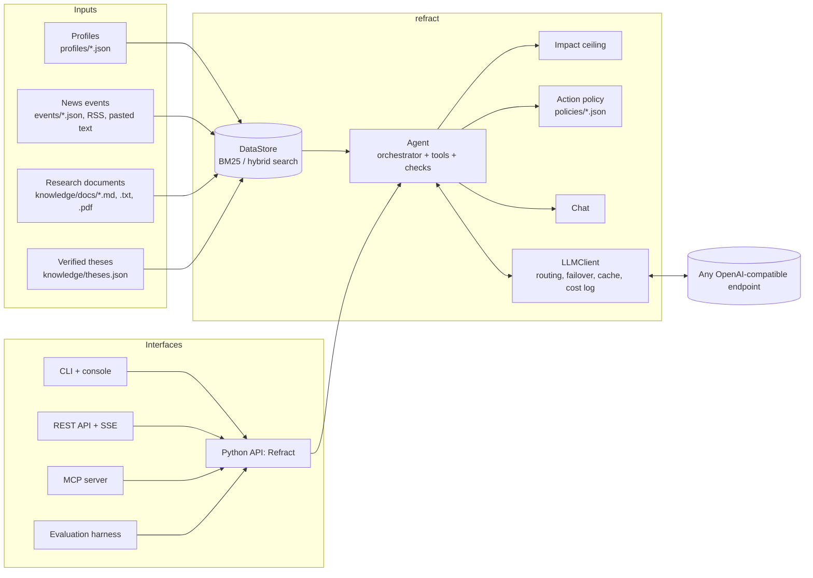

# Architecture

Refract is a library with thin interfaces around it. The agent never touches raw data or the network directly: it reads a `DataStore` and talks to a model through the `LLM` protocol, so both can be replaced.

## Layers

| Layer | Modules | Responsibility |
| --- | --- | --- |
| Contracts | `schemas/` | Pydantic models of profiles, events, theses, chunks, insights, traces, chat; the factor vocabulary; NACE sections; ISO country aliases |
| Knowledge | `knowledge/` | loading a data folder, chunking documents, BM25 and optional dense retrieval (reciprocal rank fusion), thesis extraction with quote verification |
| Model access | `llm/` | one client for any OpenAI-compatible endpoint; structured-output fallback; cost from the provider or a price table; disk cache; JSONL call log; a scripted model for tests |
| Agent | `agent/` | orchestration, context rendering, read-only tools bound to one subject, rule checks, impact ceiling, action policy, follow-up chat, progress tracking |
| Prompts | `prompts/` | one module per step, each with a version and Russian and English text |
| Interfaces | `facade.py`, `cli.py`, `shell.py`, `api.py`, `mcp_server.py`, `news/` | entry points; none of them contains agent logic |
| Demo mode | `demo.py` | scripted scenarios and the replay of recorded model answers (`Replay`, `Recorder`), so every interface runs without a model |
| Evaluation | `eval/` | systems × pairs runs, judges, statistics and the report |

## Design decisions

- **Own orchestrator instead of an agent framework.** The pipeline is short and fixed; plain code keeps every step visible in the trace and lets ablations switch components off with one flag.
- **Code decides what must not depend on the model.** Which features exist, which sources exist, which numbers exist, how strong a link is, which products are allowed. The model writes; code checks and bounds.
- **One context for all steps.** Planning, drafting, review, revision and chat see the same rendered context, so the reviewer judges exactly what the author saw and chat answers stay consistent with the insight.
- **Tools are bound to one subject.** The subject is fixed when the toolbox is created and is never a tool argument: the agent cannot request another subject's data, whatever the news text says.
- **External text is data.** News and user-provided text are wrapped in `<news>…</news>`; closing tags inside the text are removed; every system prompt says that tagged text is not instructions; phrases that look like instructions are flagged in the context.
- **Language is a run parameter.** Prompts, labels and rendered context exist in Russian and English; the JSON contract is the same in both.
- **Everything is replayable.** Model answers are cached by request hash; traces store the agent configuration and prompt versions.

## Concurrency

One `Agent` can serve several threads: per-run state lives in thread-local storage. The REST API runs each insight in a background thread and streams its progress events; `DataStore` is shared and read-only during a run except for `add_event`, which is idempotent.
